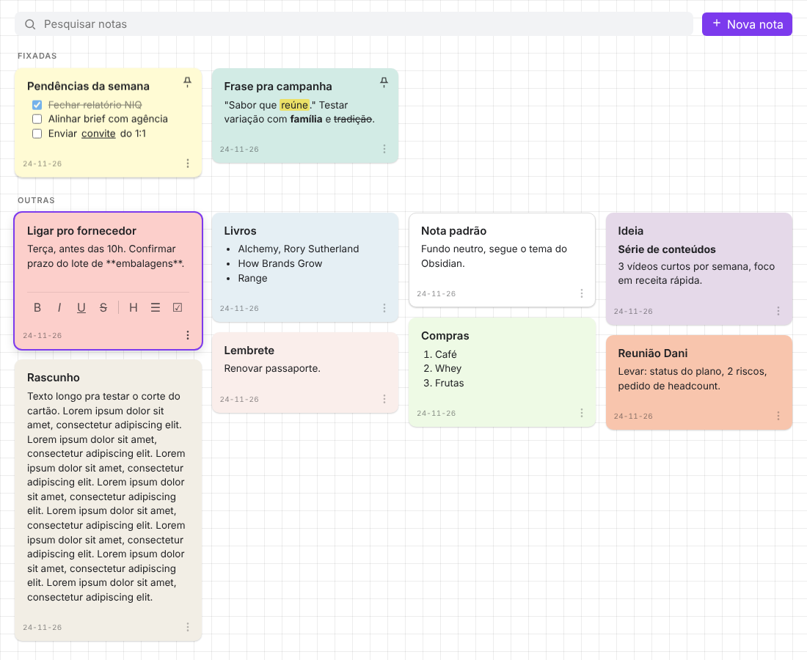

# Keep Notes para Obsidian

Notas rápidas com a cara do Google Keep dentro do Obsidian: grade de post-its coloridos,
botão **Nova nota**, pasta fixa para tudo que você cria e barra de formatação
(negrito, itálico, sublinhado, tachado, destaque, título, tópicos, numerada, tarefa, código).

Cada nota é um arquivo `.md` comum. Cor, fixação e data de criação ficam no frontmatter
(`color`, `pinned` e `created`), então nada depende do plugin para continuar legível.

## Instalação pelo BRAT (sem baixar nada)

1. Instale o plugin da comunidade **BRAT** (Obsidian42 - BRAT) e ative.
2. Em **Configurações → BRAT → Add beta plugin**, cole `ojohnmf-glitch/obsidian-keep-notes`.
3. Ative **Keep Notes** em Plugins da comunidade.

O BRAT também atualiza o plugin sozinho quando sair uma versão nova.

## Instalação manual

1. Na pasta do seu cofre, crie `.obsidian/plugins/keep-notes/`.
2. Copie para lá os três arquivos: `manifest.json`, `main.js` e `styles.css`.
3. No Obsidian: **Configurações → Plugins da comunidade** → desative o modo restrito, se preciso,
   e ative **Keep Notes**.

Sem build, sem `npm`: o plugin é JavaScript puro.

## Uso

| Ação | Como |
| --- | --- |
| Abrir a grade | Ícone de post-it na barra lateral, ou comando **Abrir notas rápidas** |
| Nova nota | Botão **Nova nota**, ícone de "arquivo +" na barra lateral, ou comando **Nova nota rápida**. Um cartão-rascunho aparece na grade; o título é obrigatório |
| Editar o texto | Clique no texto do cartão e escreva ali mesmo. Salva sozinho ao sair do cartão (ou `Ctrl+Enter`) |
| Editar o título | Clique no título do cartão |
| Barra de formatação | Menu **⋮** → **Formatação de texto** (os atalhos de teclado funcionam sempre) |
| Mudar a cor | Menu **⋮** → **Mudar cor** |
| Fixar | Alfinete no canto do cartão, ou menu **⋮** |
| Marcar tarefa | Clique na caixa direto no cartão |
| Excluir | Menu **⋮** → **Excluir**, confirmado no próprio cartão (vai para a lixeira do sistema) |
| Abrir como nota normal | Menu **⋮** → **Abrir como nota** |

A data de criação aparece no canto inferior do cartão (`DD-MM-AA`) e fica gravada no frontmatter (`created`).

Atalhos no editor: `Ctrl+B` negrito, `Ctrl+I` itálico, `Ctrl+U` sublinhado,
`Ctrl+Shift+X` tachado, `Ctrl+Shift+C` tarefa, `Ctrl+Shift+8` tópicos, `Ctrl+Enter` concluir, `Esc` sair.
`Enter` dentro de uma lista continua a lista; `Enter` em item vazio encerra.

## No celular e tablet

Funciona no Obsidian Mobile: uma coluna, botão flutuante **+** para nova nota, alvos de toque maiores
e barra de formatação aberta automaticamente ao editar (ajustável nas configurações).
Os comandos **Abrir notas rápidas** e **Nova nota rápida** podem ir para a barra de ferramentas do mobile.

## Configurações

- **Pasta das notas**: padrão `Notas rápidas`. Criada automaticamente.
- **Cor padrão** das notas novas.
- **Incluir subpastas** da pasta das notas na grade.
- **Ordenação**: por data de criação (padrão, estável) ou por última edição. Fixadas vêm sempre primeiro.
- **Barra de formatação ao editar**: só no mobile (padrão), sempre ou nunca.
- **Largura dos cartões**.

## Cores

Padrão, Coral, Pêssego, Areia, Menta, Sálvia, Névoa, Céu, Tempestade, Rosa, Giz e Cinza,
com variantes para o tema escuro.
